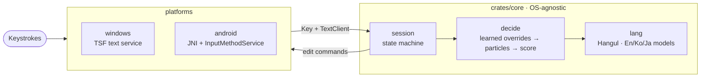

<p align="center">
  
</p>

<h1 align="center">Tacit</h1>

> When moving from **Typescript(Previous project name)**, uninstall it with its original installer before installing Tacit. Settings and learned data are not migrated automatically. Close running apps, then copy the contents of each old `Typescript` user folder into the sibling `tacit` folder (Windows: `%APPDATA%` and `%LOCALAPPDATA%` for packs; macOS: `~/Library/Application Support`; Linux: `~/.config` and `$XDG_DATA_HOME` or `~/.local/share` for packs). Android uses a new package ID and installs as a separate app; select the new keyboard in system settings.


<h3 align="center">
Type English, Korean, and Japanese on one QWERTY keyboard — it works out which language you meant, word by word. No language-toggle key.
</h3>

<p align="center">
  <a href="README.md">한국어</a> &bull; <b>English</b> &bull; <a href="docs/">Documentation</a>
</p>

<p align="center">
  <a href="#quick-start"><b>Quick start</b></a> &bull;
  <a href="#installation"><b>Install</b></a> &bull;
  <a href="#how-to-use"><b>Usage</b></a> &bull;
  <a href="#the-dashboard"><b>Dashboard</b></a> &bull;
  <a href="#troubleshooting"><b>Troubleshooting</b></a> &bull;
  <a href="#japanese"><b>Japanese</b></a> &bull;
  <a href="#config-files"><b>Config files</b></a> &bull;
  <a href="#development"><b>Development</b></a>
</p>

<p align="center">
  <a href="https://github.com/iamallyouneed/tacit/releases/latest"></a>
  <a href="https://github.com/iamallyouneed/tacit/releases"></a>
  <a href="https://github.com/iamallyouneed/tacit/actions/workflows/ci.yml"></a>
  
  
  
  
  
  
</p>

---

```
dkssudgktpdy, hello world!          →  안녕하세요, hello world!
dlrjs githubdp commitgkf rjdi       →  이건 github에 commit할 거야
fltpssm ghkdlxld                    →  리센느 화이팅
kyouhaiitenkidesune                 →  きょうはいいてんきですね   (Japanese pack)
```

Type on a plain English layout. Tacit decides, **per word**, whether you meant English, Korean (2-set Hangul), or Japanese (romaji) and converts it as you go. Wrong guess? **Press Esc once** to cycle to the next reading. Make the same correction twice and it learns the word.

## Quick start

Windows shown; other systems are under [Installation](#installation).

1. **Install.** Open PowerShell and paste one line (one admin/UAC prompt):
   ```powershell
   irm https://github.com/iamallyouneed/tacit/releases/latest/download/install.ps1 | iex
   ```
   A welcome page opens in your browser: tick your languages (English and Korean are on by default) and press Start.
2. **Pick the input method.** Press **Win+Space** and choose `Tacit (Autocomplete)`. Apps that were already open need a restart.
3. **Try it.** In Notepad type `dkssud` — you see `안녕` with a dotted underline. Space or Enter commits it.
4. **If it guessed wrong.** A word you meant in English came out as Hangul? Press **Esc**. It cycles English → Korean → …
5. **Want to tweak things?** Open the **Tacit 설정** shortcut in the Start menu → [the dashboard](#the-dashboard).

> [!TIP]
> **Settings live in the `Tacit 설정` (Tacit Settings) shortcut in the Start menu.** The installer adds it automatically; there is nothing to create.
> It opens the settings page in your browser, where you change languages, keys and per-app rules without editing files. The chat on the right lets you try a changed setting immediately.

That's it. You should never need the Han/Eng key again.

## How to use

Just type. The dotted underline shows the current guess — the same result Space/Enter will commit.

| Key | What it does |
| --- | --- |
| Letters | Continue the word; the dotted underline shows the live guess |
| Space, punctuation | Commits the word and passes the key to the app. In a Japanese word, Space opens kanji conversion ([Japanese](#japanese)) |
| Enter | Commits the underlined word only (the next Enter goes to the app). Japanese words always commit only |
| **Esc** | Cycles the reading: English → English + particle → Korean → Japanese (if enabled) |
| Shift+Esc | Cycles the reading in any app, even where Esc is passed through |
| Esc right after a commit | Re-reads the word you just committed as the next reading. Do the same correction twice and it's learned |
| Backspace | English: one letter. Korean: jamo → syllable, like a 2-set keyboard. Japanese: one kana |
| Tab | (Autocomplete profile) Completes the word from your frequent words, then the built-in dictionary. A small pill under the word previews it (`안녕하세요  Tab`). Nothing to complete → Tab goes to the app |
| ⌃K / F7, ⌃J / F6 | (Japanese) Show the reading as katakana / hiragana; Space swaps, Enter commits |
| **Han/Eng key** | By default it cycles the word's language. Alt+Han/Eng pauses/resumes Tacit for the current text field. Both are changeable on the dashboard's **Keys** tab |

**Mixed words.** English and Korean typed with no space are split for you: `githubdp` → `github에`, `reportwha` → `report좀`, `kakaotalkaptlswj` → `kakaotalk메신저`, `nwp` → `n제`.

**Learning.** Repeat a correction twice and it sticks. The autocomplete profile only suggests words you typed **2+ times**, so one-off passwords and typos never show up.

## Installation

### Windows

One line in PowerShell downloads the latest release, installs it and registers the input method (one UAC prompt). On a first install a **welcome page** opens in your browser when setup finishes: it shows what typing without the Han/Eng key feels like, lets you **pick your languages** (English and Korean are ticked; the list order is the Esc cycle order), downloads them and walks you through a short practice. An update install does not show it. The **Tutorial** link at the top of the dashboard opens it again.

```powershell
irm https://github.com/iamallyouneed/tacit/releases/latest/download/install.ps1 | iex
```

Skip the screen with `-Languages`: any combination of `en`, `ko`, `ja` (e.g. Korean only, or Japanese → English).

```powershell
& ([scriptblock]::Create((irm https://github.com/iamallyouneed/tacit/releases/latest/download/install.ps1))) -Languages ko,en,ja
```

Re-running the command on an existing install is fine (enabled languages are kept). To uninstall or pin a version:

```powershell
$i = [scriptblock]::Create((irm https://github.com/iamallyouneed/tacit/releases/latest/download/install.ps1))
& $i -Uninstall            # remove (settings and language packs are kept)
& $i -Version v0.10.10       # pinned release
& $i -Japanese             # also enable Japanese (adds to -Languages if given)
```

The downloaded zip is verified against the release's SHA-256 before anything is installed. Languages are separate packs, downloaded on demand (English and Korean about 0.45 MB, Japanese about 4.7 MB).

Installation sets **Tacit (Autocomplete)** as the Windows default input method. Updates preserve an existing Tacit default profile. Use **Win+Space** to switch input methods, or Windows **Advanced keyboard settings** to change the default. It lives under **English (United States)** (setup adds that language if missing — see [App compatibility](#app-compatibility) for why). There are two profiles:

| Profile | What it does |
| --- | --- |
| `Tacit (Autocomplete)` | Auto-detection + Tab autocomplete + learns the words you type |
| `tacit` | Auto-detection only (no autocomplete, no word history) |

<details>
<summary>Build and install from source</summary>

Needs Rust and `rustup target add i686-pc-windows-msvc`.

```powershell
.\scripts\install.ps1            # build (x64 + x86) → one UAC prompt → register
.\scripts\install.ps1 -Japanese  # also install and enable the Japanese pack
.\scripts\install.ps1 -Uninstall # remove
```

</details>

### macOS and Linux

One line, per-user, no root (downloads the release and checks its SHA-256):

```sh
curl -fsSL https://github.com/iamallyouneed/tacit/releases/latest/download/install.sh | sh
# choose languages / uninstall:
curl -fsSL https://github.com/iamallyouneed/tacit/releases/latest/download/install.sh | sh -s -- --languages ko,en,ja
curl -fsSL https://github.com/iamallyouneed/tacit/releases/latest/download/install.sh | sh -s -- --uninstall
```

- **macOS:** installs `~/Library/Input Methods/tacit.app`. Log out and back in, then add **Tacit** under System Settings → Keyboard → Input Sources. It isn't signed or notarized, so you may need to allow it in Privacy & Security the first time. There is no Han/Eng key, so **Option+Space** pauses.
- **Linux:** installs the IBus engine under `~/.local/share/tacit/`. Add **Tacit** in Settings → Keyboard → Input Sources (or `ibus-setup`); if it's missing, log out and back in. fcitx5 isn't supported yet.
- Settings live in `~/Library/Application Support/tacit/` (macOS) or `~/.config/tacit/` (Linux). Open the dashboard with `tacit-config` (needs `~/.local/bin` on your PATH).

### Android

Download **`tacit.apk`** from the [latest release](https://github.com/iamallyouneed/tacit/releases/latest) and install it (allow unknown sources). Enable **Tacit** in Settings → keyboards, then pick it from the keyboard switcher in any text field.

- The on-screen keyboard shows the 2-set jamo on each key. Bluetooth/USB keyboards work too.
- The strip above the on-screen keyboard shows how the word being typed can be read (`hello` / `ㅗ디ㅣㅐ`); tap one to switch, as with Esc. The mode key cycles `tacit` → `한` → `영`: `한` types every word as Korean, `영` types plain English, and the key faces follow.
- Password and non-text fields get plain letters, no detection.
- Release APKs share a fixed signing key, so new versions install over old ones.

### What each platform has

| | Windows | Android | macOS | Linux |
| --- | --- | --- | --- | --- |
| Form | TSF text service (x64 + x86 DLL) | `InputMethodService` APK (arm64) | InputMethodKit app (`tacit.app`, universal) | IBus engine (`ibus-engine-tacit`) |
| Input | Physical keyboard | On-screen + Bluetooth/USB | Physical keyboard | Physical keyboard |
| English & Korean | Yes | Yes | Yes | Yes |
| Tab autocomplete & learning | Yes | No | No | No |
| Japanese | **Japanese pack** | No | **Japanese pack** | **Japanese pack** |
| Pause key | Alt+Han/Eng (rebindable) | `한/영` key | Option+Space | Hangul, Pause |
| Dashboard | Yes | No | Yes | Yes |

## The dashboard

You don't need to edit files. Open the **Tacit 설정** shortcut from the Start menu (the installer adds it automatically; or run `tacit-config`; on Windows it's `C:\Program Files\tacit\tacit-config.exe`) and a settings page opens in your browser.

- It listens on this machine only (127.0.0.1) and the address contains a per-launch token, so other websites can't reach it.
- It exits by itself shortly after you close the tab.
- Changes **save immediately** and reach open apps within moments. There is no Save button.
- The dot at the top is the connection state. If the active input method isn't Tacit, a banner tells you and points you to Win+Space.
- The **chat panel on the right** is on every tab. Keys typed there go through the real input method with your saved settings, so you can change something and immediately see the effect. Typing on a blank part of the page also goes to the chat.
- Shortcuts: **1–5** switch tabs, **/** searches apps, **Esc** on the Languages tab previews the cycle.
- Settings pause while a change is being saved, with a progress message. Failed loads offer a retry button.
- In the test box, **Tab** completes a word and **Shift+Tab** moves focus out. At the 400-key limit you can still delete or send; **Clear** starts fresh. On narrow screens, **Open test** jumps to the test box.
- Search saved **App rules** and expand one to edit it. The default conversion threshold shows its inherited value. Search the entire **Taught words** list by input keys and browse 200-word pages to delete individual entries.

| Tab | What you do there |
| --- | --- |
| **Languages** (언어) | Turn languages on/off (turning one off also removes its pack; one must stay on), **reorder the Esc cycle with ↑↓**, download new packs. New languages show up under "more languages" as soon as a release includes them |
| **Input settings** (입력 설정) | Switches, each with an example: *Enter confirms only* (off = one Enter commits and breaks the line), *Tab autocomplete & word history*, *check for updates*, and — with Japanese on — *convert while typing*, *full-width digits*, *full-width space*. A "reset to default" button appears on anything you changed |
| **Keys** (키) | What the **Han/Eng key** does: cycle the word's language (default), send a shortcut (Ctrl+C, Win+L, … — press it to record), or nothing. If your laptop sends Han/Eng as Right Alt, use "set Han/Eng key" and press the real key |
| **App rules** (앱별 규칙) | Per-program behavior, keyed by exe name. Pick from running apps, type a name, or drag an `.exe` onto the page. Presets: *terminal · strict*, *game · off*, *KakaoTalk · system IME*. The *conversion threshold* slider: higher = convert only when sure, otherwise leave what you typed |
| **Update** (업데이트) | Check for a new version, refresh language packs, update the program (runs the release installer, one prompt), read the **changelog of every version** (from 0.1.0; newer releases too when there is one), and **Delete** (removes the input method and program together with what was learned, the settings and the language packs; it asks once more and the button has to be held down for 1.5 seconds, with one administrator prompt) |

The same things from the command line:

```powershell
tacit-config list                 # installed / available / enabled order
tacit-config add ja               # download and enable the Japanese pack
tacit-config remove ja            # disable and delete it
tacit-config order ko,en          # Esc order (among enabled languages)
tacit-config check                # is there a new version?
tacit-config update               # refresh packs + run the new installer
tacit-config welcome              # the first-run page: choose languages, short practice
tacit-config setup --languages ko,en   # the install-time choice, no UI (for scripts)
tacit-config setup --if-configured     # reinstall the languages already on (updates; fails on a first install)
```

A pack is installed only if its size and SHA-256 match the release's `packs.json` and its tables match the manifest hashes. New releases are checked once a day (turn off with *check for updates*). Set `TACIT_RELEASE` to a folder or URL to install from a different release (offline).

## Troubleshooting

| Symptom | Fix |
| --- | --- |
| Not in the Win+Space list | Re-run the installer. It should appear under **English (United States)**. Restart apps that were already open |
| Doesn't work in one app only | Dashboard → **App rules** → find the app → apply the "off" or "system IME" preset |
| Short terminal commands (`ls`, `git`) turn into Hangul | App rules → apply *terminal · strict* to your terminal (raises the threshold) |
| Esc is eaten / the app never sees Esc | Set `escapeToApp` for that app: Esc goes to the app, and **Shift+Esc** cycles the reading |
| Need Enter twice to get a newline | Turn off *Enter confirms only* in Input settings |
| Han/Eng key does nothing | **Keys** tab → "set Han/Eng key" and press the actual key (often Right Alt on laptops) |
| Text is chopped up in KakaoTalk | The input method must be registered under English (US), not Korean — see [App compatibility](#app-compatibility) |
| Want it off entirely | Alt+Han/Eng in the field (pause), or pick another input method with Win+Space |
| Not sure what's wrong | Use **진단 정보 복사** (Copy diagnostic information) at the top of the dashboard and attach it to your report; typed text and learned words are excluded. For extra event logs, create `%APPDATA%\tacit\debug.on` and delete it when done |

Still stuck? Open an [issue](https://github.com/iamallyouneed/tacit/issues). More in [docs/en/troubleshooting.md](docs/en/troubleshooting.md).

## Japanese

> Needs the **Japanese pack**. Turn Japanese on in the dashboard's **Languages** tab (it downloads the pack), or install with `-Japanese`. Without the pack, `"ja"` in `languages` is ignored and the rest keep working.

Space-free romaji is judged word by word and shown as kana (dotted underline). Esc cycling and commit rules match English/Korean.

```
kyouhaiitenkidesune ⏎   →  今日はいい天気ですね
kyouhagoogledekensaku ⏎ →  今日はgoogleで検索   (English words inside a phrase stay as-is)
```

- **Space opens conversion.** Pick with Space/↓ (next), ↑ (previous), 1–9, Enter (commit); Esc/Backspace return to kana editing; ←/→ grow/shrink the first phrase.
- **Kanji** come from IPADIC (390k entries + connection costs, NAIST license), word costs corrected with wordfreq frequencies. Your picks are learned per reading (`%APPDATA%\tacit\kanji_learning.json`, 5 per reading).
- Quality is below Mozc/Apple. If the first candidate is wrong, Space to the next (e.g. `ほん` → ホン, 本); correct it twice and it comes first next time.
- *Convert while typing* (`liveConversion`) shows the first candidate as you type.
- *Full-width digits/space* are off by default; `"fullWidth": false` in an app rule keeps half-width in that app (terminals).
- Inside a phrase `, . ? ! -` become 、。？！ー; a symbol after Japanese becomes its own word, committed by Return or the next word.
- To rebuild the dictionary data see `tools/build_ipadic.py` (needs IPADIC sources and a wordfreq zipf JSON).

## Config files

The dashboard covers everything below, but the JSON is yours to edit. Location: `%APPDATA%\tacit\` (macOS `~/Library/Application Support/tacit/`, Linux `~/.config/tacit/`). It's re-read when you switch apps.

`settings.json`

```json
{ "returnConfirmsOnly": true, "hangulKey": "Hangul", "hangulAction": "flip", "flipKeys": ["Esc", "HangulKey"], "pauseKeys": ["Alt+HangulKey"], "autocomplete": true,
  "languages": ["en", "ko"], "liveConversion": false, "fullWidthDigits": false, "fullWidthSpace": false }
```

| Key | Meaning |
| --- | --- |
| `returnConfirmsOnly` | `true`: Enter only commits the underlined word |
| `autocomplete` | `false` turns off Tab autocomplete and word history even in the Autocomplete profile |
| `hangulKey` | Which key is the Han/Eng key (default `"Hangul"`); `HangulKey` below refers to it |
| `hangulAction` | What the bare Han/Eng key does: `"flip"` (cycle language, default), `"none"`, or a shortcut to send (`"Ctrl+C"`, `"Win+L"`, …) |
| `flipKeys` | Keys that flip the word's language (default `["Esc", "HangulKey"]`). Combos like `"Ctrl+Space"` work; `[]` disables |
| `pauseKeys` | Pause keys (default `["Alt+HangulKey"]`). Same format; a key can't be in both lists |
| `checkUpdates` | `false` stops automatic release checks (default on) |
| `languages` | Enabled languages and Esc order: any non-empty mix of `"en"` `"ko"` `"ja"`. Languages without an installed pack are dropped |
| `liveConversion`, `fullWidthDigits`, `fullWidthSpace` | See [Japanese](#japanese) |

`apps.json` — keys are **exe file names** (case-insensitive); `"*"` is the default and app entries list only what differs. (The dashboard's *App rules* tab edits this file.)

```json
{ "*": { "escapeToApp": false },
  "windowsterminal.exe": { "conversionThreshold": 0.97 },
  "game.exe": { "enabled": false } }
```

| Key | Meaning |
| --- | --- |
| `enabled: false` | Pass keys straight through (plain English) |
| `conversionThreshold` | Default 0.5. 0.97 (strict) stops short terminal commands turning into Hangul |
| `escapeToApp: true` | Esc goes to the app; Shift+Esc cycles the reading (editors) |
| `useSystemIme: true` | Hand this app to the system Korean IME (switch with Han/Eng; see [App compatibility](#app-compatibility)) |
| `fullWidth: false` | (Japanese) keep half-width digits/space in this app (terminals) |
| `returnConfirmsOnly` | Per-app Enter behavior. `false`: one Enter both commits and sends (chat apps) |

**Built-in rules.** Without you writing anything, terminals (Windows Terminal, cmd, PowerShell, …) use threshold 0.97, editors (VS Code, Cursor, JetBrains, …) use `escapeToApp`, and chat apps (Slack, Discord, Teams, Telegram, LINE, KakaoTalk) use `returnConfirmsOnly: false`. To change one, list that app in `apps.json`; your value wins.

`user_history.json` holds the words autocomplete counted (only words typed 2+ times are suggested; numbers, mixed-script tokens and single characters are never recorded). `lexicon.json` holds words learned from your corrections.

## App compatibility

- **KakaoTalk and other RichEdit/IMM32 apps.** Windows translates a TSF composition into IMM32 messages and applies an "interim = one character" rule to *Korean* input methods, committing the rest immediately. Registered as Korean, this IME — which previews the whole word — got chopped per key (`테스트` → `ㅌpㅅmㅌm`). So it is **registered under English (US)**, where the whole word stays one composition. IMM32 apps also can't hand back keys an IME claims, so the keys that end a word and go to the app (Space, punctuation, Enter, Tab, arrows) are handled right when TSF asks about them.
- **Apps where you want the system Korean IME.** The *system IME* app rule (`useSystemIme`) hands just that process to the Microsoft Korean IME (it reverts when you leave the app).
- `cargo run -p tacit-tip --example richedit_lab -- --ts` (or `--ms`) sends real keys to a RichEdit window and prints the result and the IME messages the app receives (the same control KakaoTalk uses).

## Features

- **Per-word language detection.** Character trigrams and a word dictionary score English vs. Korean, weighted by the previous word's language and confidence.
- **Live preview.** A dotted underline shows the current guess — exactly what Space/Enter will commit.
- **Esc cycling.** English → English + particle (`github에`) → Korean → Japanese, even right after committing.
- **Per-app rules.** Strict in terminals, off in games, Esc passed through in editors.
- **Light.** Model tables are precomputed at release time into **language packs** read via memory map. The DLL stays under 4 MB and you only download the languages you use.
- **One core, four platforms.** All decision logic is an OS-agnostic Rust core; each platform feeds it keys and applies the edit commands it returns.

## Development



| Module | What it holds |
| --- | --- |
| `lang/` | Hangul composition (`hangul`), English/Korean models, particle & ending lists (`particles`), romaji→kana (`romaji`), the kana trigram model (`japanese`); language modules (`module`, `registry`, `en/` `ko/` `ja/`), the enabled language set (`set`), the pack loader (`pack`) |
| `decide/` | The decision chain: learned corrections (`learning`) → English+particle split (`mixed`) → scoring (`engine`); English inside a Japanese phrase (`segmenter`), kanji conversion (`convert`, `kanji`) |
| `session/` | The input state machine: `word`, `preview` (the underline), `flip` (Esc right after a commit), `japanese`, `client`/`key` (the boundary with the app) |
| `store/` | What persists: per-app policy & settings (`policy`), word history (`history`) |

- `crates/core` — the engine. `crates/config` — the dashboard (`tacit-config`; its web page lives in `src/web/`). `crates/packgen` — builds language packs. `platforms/` — Windows TSF DLL, Android, macOS, Linux adapters.
- A new language needs a `lang/<id>/` module, a `registry.rs` entry, engine scoring, and a pack (checklist: [docs/en/language-packs.md](docs/en/language-packs.md)).
- Deeper docs: [docs/](docs/README.md). Contributing: [CONTRIBUTING.md](CONTRIBUTING.md).

```powershell
cargo test
cargo run -p tacit-cli -- -v "dkssud hello"
echo "dkssud`tenglish" | cargo run -p tacit-cli -- --decide
cargo clippy --all-targets -- -D warnings
cargo run -p tacit-packgen --bin build-packs -- crates/core/data target/packs
```

**Releasing.** Pushing a `v*` tag runs `release.yml`: tests → builds → language packs → packaging → GitHub release. `ci.yml` runs fmt, clippy and tests on every push and PR.

## Known limitations

- The macOS and Linux input methods are only compile-checked in CI; nobody has verified real typing on those systems yet. Please report issues.
- Linux supports IBus only (GNOME default) and can't see the app name, so app rules don't apply there.
- Registered under English (US), so the taskbar language indicator reads `ENG`.
- Undoing a just-committed word (Esc) works only in apps that let TSF read text after the caret; otherwise Esc goes to the app.
- Elsewhere than Windows, no Han/Eng key means no pause key; Windows has no pause indicator yet.
- The Android on-screen keyboard tracks one finger at a time (a `KeyboardView` limitation).
- Kanji candidate ranking is below Mozc/Apple.

## License

Copyright (C) 2026 [Necessity](https://github.com/iamallyouneed). Licensed under [AGPL-3.0-only](LICENSE) (releases up to v0.4.1 were MIT and stay MIT; see [NOTICE](NOTICE)). Changes per version: [CHANGELOG.en.md](CHANGELOG.en.md). Third-party data licenses: [THIRD_PARTY_NOTICES.txt](THIRD_PARTY_NOTICES.txt).
