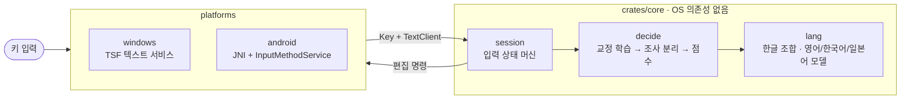

<p align="center">
  
</p>

<h1 align="center">Tacit</h1>

> 기존 **Typescript(이전 프로젝트명)**에서 옮길 때는 이전 설치기로 먼저 제거한 뒤 Tacit을 설치하세요. 설정·학습 데이터는 자동 이전하지 않습니다. 실행 중인 앱을 닫고 기존 `Typescript` 사용자 폴더의 내용을 같은 위치의 `tacit` 폴더로 복사하면 유지할 수 있습니다 (Windows: `%APPDATA%`, 팩은 `%LOCALAPPDATA%`; macOS: `~/Library/Application Support`; Linux: `~/.config`, 팩은 `$XDG_DATA_HOME` 또는 `~/.local/share`). Android는 패키지 ID가 바뀌어 별도 앱으로 설치되므로 입력기를 다시 선택해야 합니다.


<h3 align="center">
한/영 키 없이, 치는 대로 영어·한국어·일본어를 알아서 가려 주는 입력기
</h3>

<p align="center">
  <b>한국어</b> &bull; <a href="README.en.md">English</a> &bull; <a href="docs/">문서 (Docs)</a>
</p>

<p align="center">
  <a href="#1분-시작"><b>1분 시작</b></a> &bull;
  <a href="#설치"><b>설치</b></a> &bull;
  <a href="#쓰는-법"><b>쓰는 법</b></a> &bull;
  <a href="#대시보드-설정-페이지"><b>대시보드</b></a> &bull;
  <a href="#문제가-생겼을-때"><b>문제 해결</b></a> &bull;
  <a href="#일본어"><b>일본어</b></a> &bull;
  <a href="#설정-파일"><b>설정 파일</b></a> &bull;
  <a href="#개발"><b>개발</b></a>
</p>

<p align="center">
  <a href="https://github.com/iamallyouneed/tacit/releases/latest"></a>
  <a href="https://github.com/iamallyouneed/tacit/releases"></a>
  <a href="https://github.com/iamallyouneed/tacit/actions/workflows/ci.yml"></a>
  
  
  
  
  
  
</p>

---

```
dkssudgktpdy, hello world!          →  안녕하세요, hello world!
dlrjs githubdp commitgkf rjdi       →  이건 github에 commit할 거야
fltpssm ghkdlxld                    →  리센느 화이팅
kyouhaiitenkidesune                 →  きょうはいいてんきですね   (일본어 팩)
```

한/영 키를 누르지 않고 **영어 자판 그대로** 칩니다. 입력기가 **단어마다** 영어인지, 한국어(두벌식)인지, 일본어(로마자)인지 판단해서 바꿔 줍니다. 틀렸으면 **Esc 한 번**이면 다른 읽기로 바뀌고, 같은 교정을 두 번 하면 그 단어를 배웁니다.

## 1분 시작

Windows 기준입니다. 다른 OS는 [설치](#설치)를 보세요.
<br>
**windows를 제외한 환경에서 아직 충분한 검증(설치 포함)이 이루어지지 않았습니다. 빠른 시일내로 지원드리겠습니다**

1. **설치.** PowerShell을 열고 한 줄을 붙여 넣습니다. 관리자 권한 확인창이 한 번 뜹니다.
   ```powershell
   irm https://github.com/iamallyouneed/tacit/releases/latest/download/install.ps1 | iex
   ```
   끝나면 브라우저에 시작 안내 페이지가 열립니다. 쓸 언어를 고르고(영어·한국어가 기본) 시작을 누르세요.
2. **입력기 고르기.** **Win+Space** 를 눌러 `Tacit (자동완성)` 을 고릅니다. 이미 떠 있는 앱은 다시 열어야 합니다.
3. **쳐 보기.** 메모장에서 `dkssud` 를 치면 밑줄과 함께 `안녕` 이 보입니다. Space나 Enter로 확정합니다.
4. **틀렸을 때.** 영어로 쓰려던 단어가 한글로 나오면 **Esc** 를 누르세요. 영어 → 한국어 → … 순서로 바뀝니다.
5. **더 만지고 싶으면.** 시작 메뉴에서 **Tacit 설정** 을 엽니다 → [대시보드](#대시보드-설정-페이지).

> [!TIP]
> **설정은 시작 메뉴의 `Tacit 설정` 바로가기에서 합니다.** 설치하면 자동으로 추가되니 따로 만들 필요가 없습니다.
> 열면 브라우저에 설정 페이지가 뜨고, 언어·키·앱별 규칙을 파일 없이 바꿀 수 있습니다. 오른쪽 채팅창에서 바꾼 설정을 바로 쳐 볼 수 있습니다.

끝입니다. 한/영 키를 누를 일이 없어야 정상입니다.

## 쓰는 법

평소처럼 영어 자판으로 칩니다. 치는 동안 점선 밑줄이 현재 판단을 보여 주고, Space/Enter가 확정하는 것과 똑같은 결과를 미리 보여 줍니다.

| 키 | 동작 |
| --- | --- |
| 글자 | 단어를 이어 간다. 점선 밑줄로 현재 판단을 보여 준다 |
| Space, 구두점 | 단어를 확정하고 키는 앱이 그대로 받는다. 일본어 단어에서는 Space가 변환을 연다 ([일본어](#일본어)) |
| Enter | 밑줄 단어를 확정만 한다 (다음 Enter가 앱의 것). 일본어 단어는 어느 설정에서도 확정만 한다 |
| **Esc** | 읽기를 순환: 영어 → 영어+조사 → 한국어 → 일본어(켰을 때) |
| Shift+Esc | 어느 앱에서나 읽기를 순환 |
| 확정 직후 Esc | 방금 확정한 단어를 다음 읽기로 바꾼다. 같은 교정을 두 번 하면 학습한다 |
| Backspace | 영어는 글자 단위, 한국어는 두벌식처럼 자모 → 음절 단위, 일본어는 가나 한 글자 |
| Tab | (자동완성 입력기) 쓰는 중인 단어를 자주 쓴 단어로 완성하고, 기록에 없으면 내장 사전에서 완성한다. 완성할 단어는 단어 아래 작은 알약 창에 `안녕하세요  Tab` 으로 미리 보인다. 완성할 게 없으면 Tab은 앱으로 간다 |
| ⌃K / F7, ⌃J / F6 | (일본어) 읽기를 가타카나 / 히라가나로 보여 준다. Space로 둘을 뒤집고 Enter로 확정한다 |
| **한/영 키** | 기본은 단어의 언어를 돌려 바꿉니다. Alt+한/영 은 이 입력칸에서 Tacit을 끄고 켭니다 (다른 칸으로 가면 다시 켜진다). 둘 다 [키 탭](#대시보드-설정-페이지)에서 바꿉니다 |

**섞어 쓰기.** 띄어쓰기 없이 영어와 한국어를 붙여 써도 알아서 나눕니다. `githubdp` → `github에`, `reportwha` → `report좀`, `kakaotalkaptlswj` → `kakaotalk메신저`, `nwp` → `n제`.

**배우는 방식.** 같은 교정을 두 번 하면 그 단어는 다음부터 그렇게 나옵니다. 자동완성 입력기는 **2번 이상 친 단어만** 제안하므로 한 번 친 비밀번호나 오타는 나오지 않습니다.

## 설치

### Windows

PowerShell에서 한 줄이면 최신 릴리스를 받아 설치하고 입력기까지 켭니다 (관리자 권한 확인창 1회). 처음 설치하면 설치가 끝난 뒤 브라우저에 **시작 안내 페이지**가 열립니다. 한/영 키 없이 치는 맛을 보여 주고, **쓸 언어를 고르면**(영어·한국어가 기본, 목록 순서가 Esc 순환 순서) 받아서 켠 뒤 짧은 연습까지 안내합니다. 업데이트로 설치하면 뜨지 않습니다. 안내는 대시보드 위쪽의 **튜토리얼** 링크로 언제든 다시 볼 수 있습니다.

```powershell
irm https://github.com/iamallyouneed/tacit/releases/latest/download/install.ps1 | iex
```

화면 없이 바로 정하려면 `-Languages` 를 줍니다. 영어·한국어·일본어 중 1개 이상을 자유롭게 조합합니다 (예: 한국어만, 일본어 → 영어).

```powershell
& ([scriptblock]::Create((irm https://github.com/iamallyouneed/tacit/releases/latest/download/install.ps1))) -Languages ko,en,ja
```

이미 설치했다면 같은 명령을 다시 실행해도 됩니다 (켜진 언어는 그대로). 제거와 버전 지정은 스크립트 블록으로 부릅니다.

```powershell
$i = [scriptblock]::Create((irm https://github.com/iamallyouneed/tacit/releases/latest/download/install.ps1))
& $i -Uninstall            # 제거 (설정과 언어 팩은 남는다)
& $i -Version v0.10.10       # 특정 버전
& $i -Japanese             # 일본어도 켠다 (-Languages 와 같이 쓰면 거기에 더한다)
```

받은 zip은 릴리스의 SHA-256과 맞는지 확인한 뒤에만 설치합니다. 언어는 팩으로 나뉘어 필요한 것만 받습니다 (영어·한국어 약 0.45MB, 일본어 약 4.7MB).

설치하면 **Tacit (자동완성)**을 Windows 기본 입력기로 지정합니다. 업데이트할 때는 기존 Tacit 기본 프로필을 유지합니다. **Win+Space**로 다른 입력기를 고를 수 있고, 기본값은 Windows **고급 키보드 설정**에서 바꿀 수 있습니다. 언어 목록에서는 **영어(미국)** 아래에 있습니다 (없으면 설치가 영어(미국)을 추가합니다. 이유는 [앱 호환](#앱-호환)). 입력기는 둘입니다.

| 입력기 | 하는 일 |
| --- | --- |
| `Tacit (자동완성)` | 자동 판별 + Tab 자동완성 + 쓴 단어 학습 |
| `tacit` | 자동 판별만 (자동완성도, 단어 기록도 없다) |

<details>
<summary>소스에서 직접 빌드해 설치</summary>

Rust와 `rustup target add i686-pc-windows-msvc` 가 필요합니다.

```powershell
.\scripts\install.ps1            # 빌드(x64 + x86) → 관리자 권한 요청(UAC 1회) → 등록
.\scripts\install.ps1 -Japanese  # 일본어 팩도 설치하고 켠다
.\scripts\install.ps1 -Uninstall # 제거
```

아이콘은 `assets/icon.png` 를 바꾸고 `.\scripts\make-icon.ps1` 후 다시 설치하면 됩니다.

</details>

### macOS와 Linux

한 줄로 설치합니다 (현재 사용자에게만 설치하고 관리자 권한은 필요 없습니다. 릴리스를 받아 SHA-256을 확인합니다).

```sh
curl -fsSL https://github.com/iamallyouneed/tacit/releases/latest/download/install.sh | sh
# 언어를 고르거나 제거할 때:
curl -fsSL https://github.com/iamallyouneed/tacit/releases/latest/download/install.sh | sh -s -- --languages ko,en,ja
curl -fsSL https://github.com/iamallyouneed/tacit/releases/latest/download/install.sh | sh -s -- --uninstall
```

- **macOS:** `~/Library/Input Methods/tacit.app` 로 설치됩니다. 로그아웃했다가 다시 들어온 뒤 시스템 설정 → 키보드 → 입력 소스 → 편집에서 **Tacit** 를 추가합니다. 서명·공증을 하지 않아 처음에는 개인정보 보호 및 보안에서 허용해야 할 수 있습니다. 한/영 키가 없으니 **Option+Space** 가 일시정지입니다.
- **Linux:** IBus 엔진이 `~/.local/share/tacit/` 에 설치됩니다. 설정 → 키보드 → 입력 소스(또는 `ibus-setup`)에서 **Tacit** 를 추가합니다. 목록에 없으면 로그아웃했다가 다시 들어오세요. fcitx5는 아직 지원하지 않습니다.
- 설정은 macOS에서 `~/Library/Application Support/tacit/`, Linux에서 `~/.config/tacit/` 에 저장됩니다. 설정 페이지는 `tacit-config` 로 엽니다 (`~/.local/bin` 이 PATH에 있어야 합니다).

### Android

릴리스의 **`tacit.apk`** 를 받아 설치합니다 (출처를 알 수 없는 앱 허용 필요). 설정 → 키보드 목록에서 **Tacit** 를 켜고, 입력창에서 키보드로 고릅니다. 화면과 함께 따라 하려면 **[Android 설치 가이드](docs/ko/android.md)** 를 보세요.

- 화면 키보드는 두벌식 자모를 키마다 같이 표시합니다. 블루투스/USB 물리 키보드도 됩니다.
- 화면 키보드 위의 후보 띠에서 입력 중인 단어의 해석(`hello` / `ㅗ디ㅣㅐ`)을 눌러 바꿉니다(Esc와 같습니다). `한/영` 키는 `tacit` → `한` → `영` 순으로 바뀝니다. `한`은 모든 단어를 한글로, `영`은 일반 영문으로 입력하고 키 글자도 그에 맞게 바뀝니다.
- 비밀번호 칸과 텍스트가 아닌 칸에서는 판별 없이 글자만 넣습니다.
- 릴리스 APK는 고정된 키로 서명돼서 새 버전을 덮어 설치할 수 있습니다.

<details>
<summary>APK 직접 빌드</summary>

```powershell
.\platforms\android\build.ps1                 # platforms\android\build\tacit.apk (arm64 + x86_64)
.\platforms\android\build.ps1 -Abi arm64-v8a  # 폰용만
adb install -r platforms\android\build\tacit.apk
```

Android SDK(build-tools, platform 34), NDK, JDK 17, `rustup target add aarch64-linux-android x86_64-linux-android`, `cargo install cargo-ndk` 가 필요합니다. 직접 빌드하면 디버그 키로 서명되므로 릴리스 APK와는 덮어 설치되지 않습니다. 릴리스 키로 서명하려면 `TS_KEYSTORE`, `TS_KEYSTORE_PASS` 환경변수를 주세요 (별칭은 `tacit`).

</details>

### 지원 현황

| | Windows | Android | macOS | Linux |
| --- | --- | --- | --- | --- |
| 형태 | TSF 텍스트 서비스 (x64 + x86 DLL) | `InputMethodService` APK (arm64) | InputMethodKit 입력기 (`tacit.app`, 유니버설) | IBus 엔진 (`ibus-engine-tacit`) |
| 입력 | 물리 키보드 | 화면 키보드 + 블루투스/USB 키보드 | 물리 키보드 | 물리 키보드 |
| 영어·한국어 | 있음 | 있음 | 있음 | 있음 |
| 자동완성(Tab)·단어 학습 | 있음 | 없음 | 없음 | 없음 |
| 일본어 | **일본어 팩** | 없음 | **일본어 팩** | **일본어 팩** |
| 일시정지 키 | Alt+한/영 (바꿀 수 있음) | `한/영` 키 | Option+Space | 한/영 (Hangul), Pause |
| 대시보드 | 있음 | 없음 | 있음 | 있음 |

## 대시보드 (설정 페이지)

설정은 파일을 고칠 필요 없이 대시보드에서 합니다. 시작 메뉴의 **Tacit 설정** 바로가기(설치할 때 자동으로 추가됩니다. 또는 `C:\Program Files\tacit\tacit-config.exe`, macOS·Linux는 `tacit-config`)을 실행하면 브라우저에 설정 페이지가 열립니다.

- 이 컴퓨터(127.0.0.1)에서만 열리고, 실행할 때마다 바뀌는 토큰이 주소에 들어 있어 다른 사이트는 접근할 수 없습니다.
- 탭을 닫으면 잠시 뒤 스스로 끝납니다.
- 바꾸면 **바로 저장**되고, 열려 있는 앱에는 곧 반영됩니다. 저장 버튼은 없습니다.
- 상단의 점은 연결 상태입니다. 지금 선택된 입력기가 Tacit이 아니면 위쪽에 알려 주고 Win+Space로 바꾸라고 안내합니다.
- **오른쪽의 채팅창**은 모든 탭에서 보입니다. 여기서 치는 키는 실제 입력기를 거치므로, 설정을 바꾸고 바로 어떻게 달라지는지 쳐 볼 수 있습니다. 입력창 밖 빈 곳에서 글자를 쳐도 채팅에 들어갑니다.
- 단축키: 숫자 **1–5** 로 탭 이동, **/** 로 앱 찾기, 언어 탭에서 **Esc** 로 순환 미리 보기.
- 저장 중에는 설정 조작을 잠시 막고 진행 상태를 표시합니다. 불러오기에 실패하면 **다시 시도**할 수 있습니다.
- 테스트창에서 **Tab**은 자동완성, **Shift+Tab**은 입력창 밖으로 이동합니다. 400키 한도에서도 삭제·전송할 수 있고, **지우기**로 새로 시작합니다. 좁은 화면에서는 **테스트 열기**로 바로 이동합니다.
- **앱별 규칙**은 등록된 규칙을 검색하고 펼쳐 편집합니다. ‘기본’ 변환 기준에는 실제 상속값도 표시합니다. **가르친 단어**는 전체 목록을 입력 키로 검색하고 200개씩 페이지를 넘겨 개별 삭제할 수 있습니다.

| 탭 | 여기서 하는 일 |
| --- | --- |
| **언어** | 쓸 언어 켜기·끄기 (끌 때 그 팩도 지웁니다, 마지막 하나는 못 끕니다), **Esc 순서를 ↑↓로 바꾸기**, 새 언어 팩 받기. 새 언어는 릴리스에 올라오는 대로 "더 쓸 수 있는 언어"에 나타납니다 |
| **입력 설정** | 스위치 모음. *Enter는 확정만* (끄면 한 번에 확정+줄바꿈), *Tab 자동완성과 단어 기록*, *새 버전 확인*, 그리고 일본어를 켰다면 *치는 동안 바로 변환* · *전각 숫자* · *전각 공백*. 각 항목에 예시가 붙어 있고, 기본값이 아니면 "기본값으로" 버튼이 보입니다 |
| **키** | **한/영 키를 누르면** 무엇을 할지 정합니다: 단어 언어 전환(기본) · 단축키 보내기(Ctrl+C, Win+L 등, 눌러서 지정) · 아무것도 안 함. 노트북처럼 한/영 키가 오른쪽 Alt로 오는 키보드는 "한/영 키 지정"에서 그 키를 눌러 알려 주세요 |
| **앱별 규칙** | 프로그램(exe 파일 이름)마다 다르게 동작하게 합니다. 열려 있는 앱 목록에서 고르거나 이름을 적고, `.exe` 를 화면으로 끌어다 놓아도 됩니다. 프리셋: *터미널 · 엄격*, *게임 · 끄기*, *카카오톡 · 시스템 IME*. *변환 기준* 슬라이더는 높을수록 확실할 때만 바꾸고, 아니면 친 그대로 둡니다 |
| **업데이트** | 새 버전 확인, 언어 팩 갱신, 프로그램 업데이트(릴리스 설치기를 실행, 확인창 1회), **전체 버전의 변경 기록**(0.1.0부터, 새 버전이 있으면 그 기록도), **삭제**(입력기·프로그램과 배운 단어·설정·언어 팩을 모두 지움. 한 번 더 묻고, 버튼을 1.5초 꾹 눌러야 지워지며 관리자 확인창이 1회 뜹니다) |

같은 일을 명령으로도 할 수 있습니다.

```powershell
tacit-config list                 # 설치됨 / 받을 수 있음 / 켜짐 순서
tacit-config add ja               # 일본어 팩을 받고 켠다
tacit-config remove ja            # 끄고 팩을 지운다
tacit-config order ko,en          # Esc 순서 (켜진 언어끼리만 바꿀 수 있다)
tacit-config check                # 새 버전이 있는지
tacit-config update               # 언어 팩 갱신 + 새 프로그램 설치기 실행
tacit-config welcome              # 시작 안내 페이지: 언어 고르기 + 짧은 연습
tacit-config setup --languages ko,en   # 설치 때 쓰는 선택 (화면 없이, 스크립트용)
tacit-config setup --if-configured     # 이미 켜 둔 언어를 다시 설치 (업데이트용, 처음 설치면 실패)
```

받은 팩은 릴리스 목록(`packs.json`)의 SHA-256과 크기가 맞고, 안의 표 파일이 manifest의 해시와 맞을 때만 설치됩니다. 하루에 한 번 새 릴리스를 확인해 알려 줍니다 (끄려면 입력 설정의 *새 버전 확인*). `TACIT_RELEASE` 에 폴더나 주소를 주면 다른 릴리스(오프라인 설치)를 씁니다.

## 문제가 생겼을 때

| 증상 | 해결 |
| --- | --- |
| Win+Space 목록에 Tacit이 없다 | 설치를 다시 실행하세요. **영어(미국)** 아래에 있어야 합니다. 이미 떠 있던 앱은 다시 열어야 새 입력기를 읽습니다 |
| 어떤 앱에서만 안 된다 | 대시보드 **앱별 규칙**에서 그 앱을 찾아 "끄기"나 "시스템 IME" 프리셋을 적용해 보세요 |
| 터미널에서 짧은 명령(`ls`, `git`)이 한글로 바뀐다 | 앱별 규칙에서 터미널에 *터미널 · 엄격* 프리셋을 적용하세요 (변환 기준을 올립니다) |
| 에디터에서 Esc가 먹힌다 / 앱의 Esc가 안 간다 | 앱 규칙의 `escapeToApp` 을 켜면 Esc는 앱으로 가고, 읽기 순환은 **Shift+Esc** 입니다 |
| Enter를 두 번 눌러야 줄바꿈된다 | 입력 설정의 *Enter는 확정만* 을 끄세요 |
| 한/영 키가 반응이 없다 | **키** 탭에서 "한/영 키 지정"으로 실제 키를 알려 주세요 (오른쪽 Alt인 노트북이 많습니다) |
| 카카오톡에서 글자가 끊긴다 | 입력기가 영어(미국) 아래에 등록돼 있어야 합니다. 한국어 아래에 두면 안 됩니다 ([앱 호환](#앱-호환)) |
| 완전히 끄고 싶다 | 입력칸에서 Alt+한/영 (일시정지), 또는 Win+Space로 다른 입력기를 고르세요 |
| 원인을 모르겠다 | 대시보드 위쪽의 **진단 정보 복사**를 눌러 문의에 첨부하세요 (입력한 글자·학습 단어는 제외). 추가 이벤트 로그가 필요하면 `%APPDATA%\tacit\debug.on`을 만들고, 확인 후 지우세요 |

그래도 안 되면 [이슈](https://github.com/iamallyouneed/tacit/issues)로 알려 주세요. 자세한 내용은 [docs/ko/troubleshooting.md](docs/ko/troubleshooting.md) 에 있습니다.

## 일본어

> **일본어 팩**이 있어야 됩니다. 대시보드 **언어** 탭에서 일본어를 켜면 받아서 켜 줍니다 (또는 설치 때 `-Japanese`). 팩이 없으면 `languages` 에 `"ja"` 가 있어도 그 언어는 빠지고 나머지로 동작합니다.

공백 없이 친 로마자를 단어마다 일본어로 읽을지 판단해 가나로 보여 주고 (점선 밑줄), Esc 순환과 확정 규칙은 영어/한국어와 같습니다.

```
kyouhaiitenkidesune ⏎   →  今日はいい天気ですね
kyouhagoogledekensaku ⏎ →  今日はgoogleで検索   (문구 안 영어 단어는 그대로)
```

- **Space가 변환을 엽니다.** 후보를 Space/↓(다음), ↑(이전), 1–9, Enter(확정)로 고르고, Esc/Backspace는 가나 편집으로 돌아갑니다. ←/→는 첫 구절의 경계를 늘리고 줄입니다.
- **한자 변환**은 IPADIC 사전(39만 항목 + 연결 비용, NAIST 라이선스)으로 하고, 단어 비용은 wordfreq 빈도로 보정합니다. 고른 후보는 읽기별로 학습합니다 (`%APPDATA%\tacit\kanji_learning.json`, 읽기당 5개).
- 품질은 Mozc·Apple 엔진보다 낮습니다. 첫 후보가 틀리면 Space로 넘기면 되고(예: `ほん` → ホン, 本 순서), 같은 교정을 두 번 하면 다음부터 먼저 나옵니다.
- 입력 설정의 *치는 동안 바로 변환* (`liveConversion`) 을 켜면 치는 동안 첫 후보를 바로 보여 줍니다.
- *전각 숫자·공백* 은 기본 꺼짐입니다. 앱 규칙의 `"fullWidth": false` 로 그 앱에서만 반각으로 둘 수 있습니다 (터미널).
- 문구 안에서 `, . ? ! -` 는 、。？！ー 로 붙고, 일본어 뒤의 기호는 스스로 한 단어가 되어 Return이나 다음 단어가 확정합니다.
- 사전 데이터를 다시 만들려면 `tools/build_ipadic.py` (IPADIC 원본과 wordfreq zipf JSON이 필요합니다 — 도구 설명 참고).

## 설정 파일

대시보드로 충분하지만, JSON을 직접 편집해도 됩니다. 위치는 `%APPDATA%\tacit\` (macOS `~/Library/Application Support/tacit/`, Linux `~/.config/tacit/`). 앱 간 전환할 때 다시 읽습니다.

`settings.json`

```json
{ "returnConfirmsOnly": true, "hangulKey": "Hangul", "hangulAction": "flip", "flipKeys": ["Esc", "HangulKey"], "pauseKeys": ["Alt+HangulKey"], "autocomplete": true,
  "languages": ["en", "ko"], "liveConversion": false, "fullWidthDigits": false, "fullWidthSpace": false }
```

| 키 | 뜻 |
| --- | --- |
| `returnConfirmsOnly` | `true`면 Enter는 밑줄 단어를 확정만 한다 |
| `autocomplete` | `false`면 `Tacit (자동완성)` 에서도 Tab 자동완성과 단어 기록을 끈다 |
| `hangulKey` | 한영키로 쓸 키 (기본 `"Hangul"`). 아래 목록의 `HangulKey`가 이 키를 가리킨다 |
| `hangulAction` | 한/영 키만 눌렀을 때 하는 일: `"flip"`(단어 언어 전환, 기본) · `"none"` · 앱에 보낼 단축키(`"Ctrl+C"`, `"Win+L"` …) |
| `flipKeys` | 단어의 언어를 바꾸는 키 목록 (기본 `["Esc", "HangulKey"]`). `"Ctrl+Space"` 같은 조합도 되고 `[]`이면 끈다 |
| `pauseKeys` | 일시정지 키 목록 (기본 `["Alt+HangulKey"]`). 형식은 같고 두 목록에 같은 키를 쓸 수 없다 |
| `checkUpdates` | `false`면 새 릴리스를 자동으로 확인하지 않는다 (기본 켜짐) |
| `languages` | 켜진 언어와 Esc 순환 순서. `"en"` `"ko"` `"ja"` 중 1개 이상, 자유 조합. 팩이 없는 언어는 빠진다 |
| `liveConversion`, `fullWidthDigits`, `fullWidthSpace` | [일본어](#일본어) 참고 |

`apps.json` — 키는 **exe 파일 이름**(대소문자 무시). `"*"` 는 기본값이고, 앱 항목에는 다른 키만 적습니다. (대시보드 *앱별 규칙* 이 이 파일을 편집합니다.)

```json
{ "*": { "escapeToApp": false },
  "windowsterminal.exe": { "conversionThreshold": 0.97 },
  "game.exe": { "enabled": false } }
```

| 키 | 뜻 |
| --- | --- |
| `enabled: false` | 키를 그대로 통과 (영문 입력) |
| `conversionThreshold` | 기본 0.5. 0.97(엄격)은 터미널에서 짧은 명령이 한글로 바뀌는 것을 막는다 |
| `escapeToApp: true` | Esc를 앱에 넘기고 Shift+Esc로 읽기를 바꾼다 (에디터) |
| `useSystemIme: true` | 그 앱에서는 시스템 한국어 입력기로 넘긴다 (한/영 키로 전환. [앱 호환](#앱-호환)) |
| `fullWidth: false` | (일본어) 그 앱에서는 전각 숫자·공백을 반각으로 둔다 (터미널) |
| `returnConfirmsOnly` | 그 앱에서만 Enter 동작을 정한다. `false`면 Enter 한 번에 확정과 전송이 같이 된다 (메신저) |

**기본으로 들어 있는 규칙.** 적어 주지 않아도 터미널(Windows Terminal, cmd, PowerShell …)은 변환 기준 0.97, 에디터(VS Code, Cursor, JetBrains …)는 `escapeToApp`, 메신저(Slack, Discord, Teams, Telegram, LINE, 카카오톡)는 `returnConfirmsOnly: false` 입니다. 바꾸려면 그 앱을 `apps.json` 에 적으세요. 적은 값이 우선합니다.

`user_history.json` 은 자동완성 입력기가 센 단어(2번 이상 친 것만 제안, 숫자·영한 섞인 토큰·1글자는 기록 안 함), `lexicon.json` 은 교정으로 배운 단어입니다. 직접 고쳐도 됩니다.

## 앱 호환

- **카카오톡, RichEdit 기반 앱 (IMM32 앱).** Windows는 TSF 입력기의 조합을 IMM32 메시지로 바꿔 주는데, *한국어* 입력기에는 "조합은 한 글자(interim)" 규칙을 적용해 나머지를 바로 확정합니다. 단어 전체를 미리보기로 보여 주는 이 입력기는 한국어로 등록하면 키마다 끊겼습니다 (`테스트` → `ㅌpㅅmㅌm`). 그래서 **영어(미국)로 등록합니다.** 그러면 같은 앱에서도 단어 전체가 하나의 조합으로 유지됩니다. 또 IMM32 앱은 입력기가 "가져가겠다"고 한 키를 돌려받지 못하므로, 단어를 끝내고 앱으로 넘어가는 키(Space, 구두점, Enter, Tab, 방향키)는 TSF가 키를 물어보는 단계에서 바로 처리합니다.
- **시스템 한국어 입력기를 쓰고 싶은 앱.** 앱별 규칙의 *시스템 IME* (`useSystemIme`) 로 그 프로세스만 Microsoft 한국어 IME로 넘길 수 있습니다 (다른 앱으로 가면 되돌아옵니다).
- `cargo run -p tacit-tip --example richedit_lab -- --ts` (또는 `--ms`) 는 RichEdit 창에 실제 키를 보내 결과와 앱이 받는 IME 메시지를 찍습니다 (카카오톡과 같은 컨트롤).

## 특징

- **단어 단위 자동 판별.** 글자 모델(트라이그램)과 단어 사전으로 영어/한국어를 점수 매기고, 앞 단어의 언어와 확신도를 함께 봅니다.
- **치는 동안 보이는 미리보기.** 점선 밑줄로 현재 판단을 보여 주고, Space/Enter가 확정하는 것과 같은 결과를 미리 보여 줍니다.
- **Esc로 순환.** 영어 → 영어+조사(`github에`) → 한국어 → 일본어. 확정한 직후에도 Esc로 되돌립니다.
- **앱마다 다른 규칙.** 터미널에서는 엄격하게, 게임에서는 끄고, 에디터에서는 Esc를 앱에 넘깁니다.
- **가볍게.** 모델 테이블은 릴리스 때 미리 계산해 **언어 팩**으로 나눠 두고, 입력기는 팩을 메모리 맵으로 읽습니다. DLL은 4MB 안쪽이고 언어는 필요한 팩만 받습니다.
- **Windows, Android, macOS, Linux가 같은 코어.** 판별 로직은 OS를 모르는 Rust 코어 하나이고, 플랫폼은 키를 넣고 편집 명령을 받아 적용합니다.

## 개발



| 모듈 | 내용 |
| --- | --- |
| `lang/` | 한글 조합(`hangul`), 한국어/영어 모델, 조사·어미 목록(`particles`), 로마자→가나(`romaji`), 가나 트라이그램 모델(`japanese`); 언어 모듈(`module`, `registry`, `en/` `ko/` `ja/`), 켜진 언어 집합(`set`), 언어 팩 로더(`pack`) |
| `decide/` | 판별 엔진 체인: 교정 학습(`learning`) → 영어+조사 분리(`mixed`) → 점수(`engine`); 문구 안 영어 분리(`segmenter`), 한자 변환(`convert`, `kanji`) |
| `session/` | 입력 상태 머신: `word`, `preview`(밑줄), `flip`(확정 직후 Esc), `japanese`, `client`/`key`(앱과의 경계) |
| `store/` | 디스크에 남는 것: 앱별 정책·설정(`policy`), 단어 기록(`history`) |

- `crates/config` 가 대시보드(`tacit-config`)입니다. 웹 페이지(`src/web/`)를 바이너리에 넣어 로컬 서버로 엽니다.
- `platforms/windows` 가 TSF COM DLL이고 언어 데이터는 설치된 팩(`%LOCALAPPDATA%\tacit\packs`)에서 읽습니다. `platforms/android` 는 코어를 JNI로 감싼 Rust 라이브러리와 Java `InputMethodService` 입니다.
- 언어 데이터는 `crates/packgen` 이 팩(`manifest.json` + 표 파일)으로 만듭니다. 새 언어는 `lang/<id>/` 모듈, `registry.rs` 등록, 엔진 점수, 팩 등록이 필요합니다 (목록은 [docs/ko/language-packs.md](docs/ko/language-packs.md)).
- 더 깊은 설명은 [docs/](docs/README.md) 에 있습니다. 기여 방법은 [CONTRIBUTING.md](CONTRIBUTING.md).

```powershell
cargo test                                   # core 단위/통합 테스트
cargo run -p tacit-cli -- -v "dkssud hello"
echo "dkssud`tenglish" | cargo run -p tacit-cli -- --decide
cargo clippy --all-targets -- -D warnings
cargo run -p tacit-packgen --bin build-packs -- crates/core/data target/packs   # 릴리스 팩 (en, ko, ja)
```

**릴리스.** `v` 로 시작하는 태그를 푸시하면 GitHub Actions(`release.yml`)가 테스트 → 빌드 → 언어 팩 생성 → 패키징 → 릴리스까지 합니다. 푸시와 PR마다 `ci.yml` 이 fmt, clippy, 테스트를 돌립니다.

```powershell
git tag v0.8.7; git push origin v0.8.7
```

## 알려진 한계

- macOS·Linux 입력기는 CI에서 컴파일까지만 확인합니다. 실제 입력 동작은 아직 사람이 해당 OS에서 검증하지 못했습니다. 문제가 있으면 이슈로 알려 주세요.
- Linux는 IBus만 지원하고(GNOME 기본), 앱 이름을 알 수 없어 앱별 규칙이 적용되지 않습니다. 확정한 글자를 되돌리는 동작은 IBus 입력 중인 단어에서만 됩니다.
- 영어(미국) 아래에 등록되므로 작업 표시줄의 언어 표시는 `ENG` 입니다.
- TSF 동작은 앱마다 다릅니다. 확정 직후 Esc(되돌리기)는 캐럿 뒤 텍스트를 읽을 수 있는 앱에서만 되고, 읽지 못하면 Esc는 앱에 전달됩니다.
- 다른 플랫폼은 한/영 키가 없으면 일시정지 키가 없습니다. 일시정지 상태를 보여 주는 표시도 Windows에는 아직 없습니다.
- Android 화면 키보드는 한 번에 한 손가락만 인식합니다 (프레임워크 `KeyboardView`의 한계).
- 자동완성 제안은 단어 아래 창으로만 보입니다 (글자 안에 회색으로 붙이는 방식은 아님).
- (일본어) 한자 후보의 순위는 IPADIC+빈도 보정 수준이라 Mozc·Apple 엔진보다 낮습니다.

## 라이선스

Copyright (C) 2026 [Necessity](https://github.com/iamallyouneed). [AGPL-3.0-only](LICENSE) 입니다 (v0.4.1까지의 릴리스는 MIT였고 그대로 남습니다. 원저작자 고지는 [NOTICE](NOTICE)). 버전별 변경은 [CHANGELOG.md](CHANGELOG.md) 에 있습니다. 데이터 라이선스는 [THIRD_PARTY_NOTICES.txt](THIRD_PARTY_NOTICES.txt) 에 있습니다 (`korean_vocabulary.txt` 는 CC BY-SA 4.0, `kana_trigrams.bin` 는 Tatoeba CC-BY 2.0 FR).
